# PM App - aplikacja do zarządzania projektami

Aplikacja internetowa do organizacji pracy zespołów: od założenia projektu, przez przydzielanie zadań, po śledzenie postępów i wymianę komentarzy. Projekt powstał jako praktyczne ćwiczenie z budowania aplikacji webowej w PHP i MySQL. Łączy logikę serwerową, relacyjną bazę danych i interfejs dla trzech typów użytkowników.

## Najważniejsze funkcje

- Rejestracja, logowanie, profil użytkownika oraz reset hasła przez e-mail.
- Zatwierdzanie nowych kont przez administratora.
- Zespoły i członkostwa użytkowników.
- Projekty przypisane do zespołów oraz zadania z terminem, statusem, priorytetem i osobą odpowiedzialną.
- Widok Kanban do przeglądania zadań, komentarze i powiadomienia o zmianach oraz zbliżających się terminach.
- Wyszukiwanie projektów, zespołów i użytkowników.
- Oddzielne motywy interfejsu dopasowane do ról.

## Technologie

| Obszar | Technologie |
|---|---|
| Backend | PHP 8, PDO, sesje PHP |
| Baza danych | MySQL |
| Interfejs | HTML5, CSS3, JavaScript |
| Biblioteki i integracje | jQuery, PHPMailer, Google reCAPTCHA v2, DOMPurify, ikony Fontello |
| Narzędzia lokalne | Composer, XAMPP, phpMyAdmin |

Aplikacja korzysta z przygotowanych zapytań PDO. PHPMailer jest instalowany przez Composer, a część bibliotek interfejsu jest ładowana z CDN.

## Role i zakres dostępu

| Rola | Zakres pracy |
|---|---|
| **Administrator** | Zarządza użytkownikami i zatwierdza nowe konta. Ma dostęp do danych zespołów, projektów i zadań. |
| **Kierownik projektu** | Prowadzi zespoły, zarządza ich członkami, projektami i zadaniami. Pracuje w zespołach, do których należy. |
| **Członek zespołu** | Przegląda przypisane zadania, aktualizuje ich status, dodaje komentarze i otrzymuje powiadomienia. |

Rejestracja jest dostępna dla kierowników projektu i członków zespołu. Nowe konto wymaga zatwierdzenia przez administratora. Konta administratora nie można utworzyć przez formularz rejestracji.

## Model danych i rozwiązania

Aplikacja opiera się na relacjach między użytkownikami, zespołami, projektami, zadaniami i komentarzami. Użytkownik może należeć do wielu zespołów, projekt należy do jednego zespołu, a zadanie do jednego projektu. Członkowie zespołu widzą zadania przypisane do ich konta.

W projekcie wykorzystałem między innymi:

- podział funkcji według ról oraz zatwierdzanie kont;
- haszowanie haseł przez password_hash() i weryfikację przez password_verify();
- obsługę danych formularzy i zapytań do bazy po stronie PHP;
- komunikację asynchroniczną w wybranych funkcjach interfejsu;
- tokeny resetu hasła przechowywane jako skrót i ograniczone czasowo;
- wspólne widoki i arkusze stylów dla ekranów poszczególnych ról.

To projekt typu MVP do nauki i prezentacji umiejętności. Przed wdrożeniem produkcyjnym wymagałby przeglądu konfiguracji, bezpieczeństwa oraz pełnego zakresu uprawnień.

## Struktura repozytorium

- admin/, manager/ i user/ — strony oraz obsługa działań dla poszczególnych ról;
- view/ i template/ — wspólne układy oraz fragmenty interfejsu;
- css/, scripts/ i assets/ — style, skrypty przeglądarkowe i zasoby;
- functions.php — współdzielone funkcje aplikacji;
- connect.php — połączenie z bazą danych;
- project_management.sql — struktura i przykładowe dane.

## Uruchomienie lokalne

Wymagane są PHP 8+, Composer i MySQL. Poniższe kroki zakładają środowisko XAMPP na Windows.

1. Umieść repozytorium w katalogu htdocs, na przykład C:/xampp/htdocs/project_management.
2. Uruchom Apache i MySQL w XAMPP.
3. Utwórz bazę danych i zaimportuj do niej plik [project_management.sql](./project_management.sql).
4. Sprawdź ustawienia połączenia z bazą w connect.php.
5. Zainstaluj zależności PHP:

       composer install

6. Utwórz lokalne pliki config.php i PHPMailerConfig.php z kluczami reCAPTCHA oraz ustawieniami SMTP. Nie zapisuj prywatnych kluczy ani danych logowania do poczty w repozytorium.
7. Otwórz http://localhost/project_management/ w przeglądarce.

Zrzut bazy zawiera przykładowe dane. Po pierwszym logowaniu zmień hasło konta użytego do demonstracji.

## Zrzuty ekranu

### Logowanie i rejestracja

  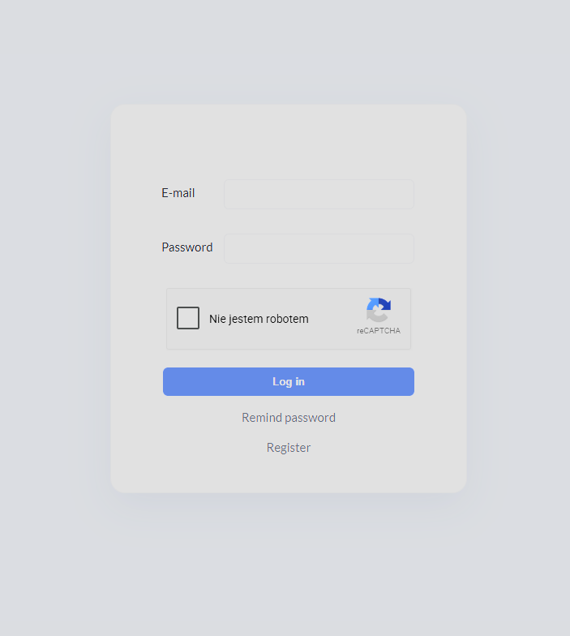

  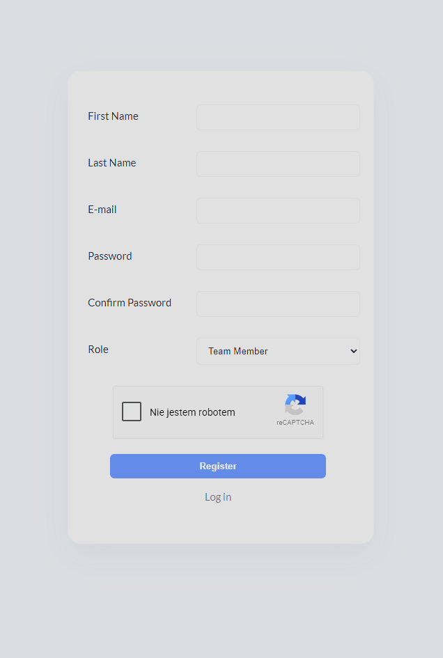

  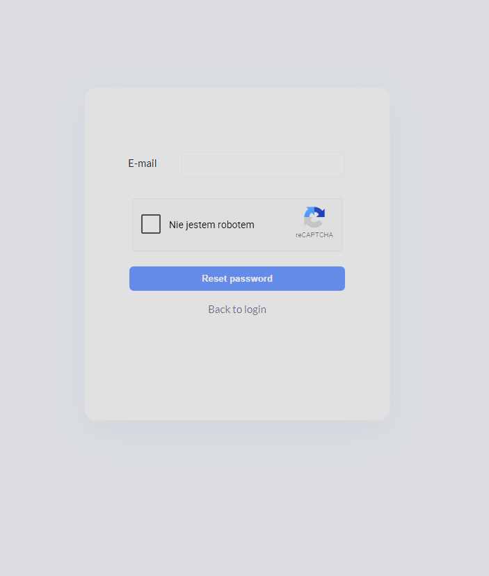

### Pulpit i projekty

  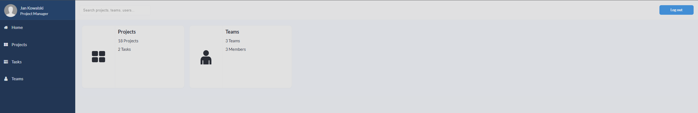

  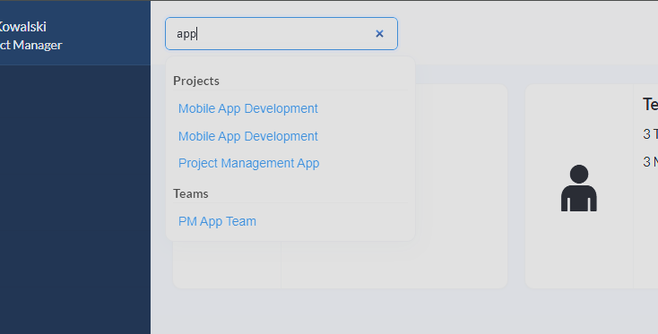

  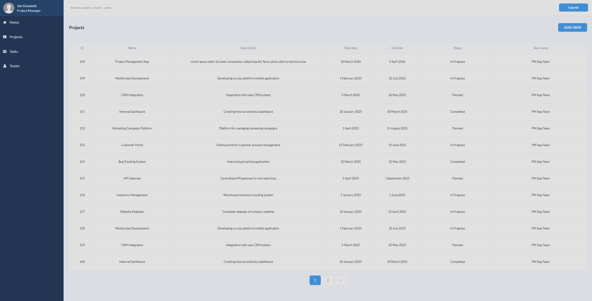

  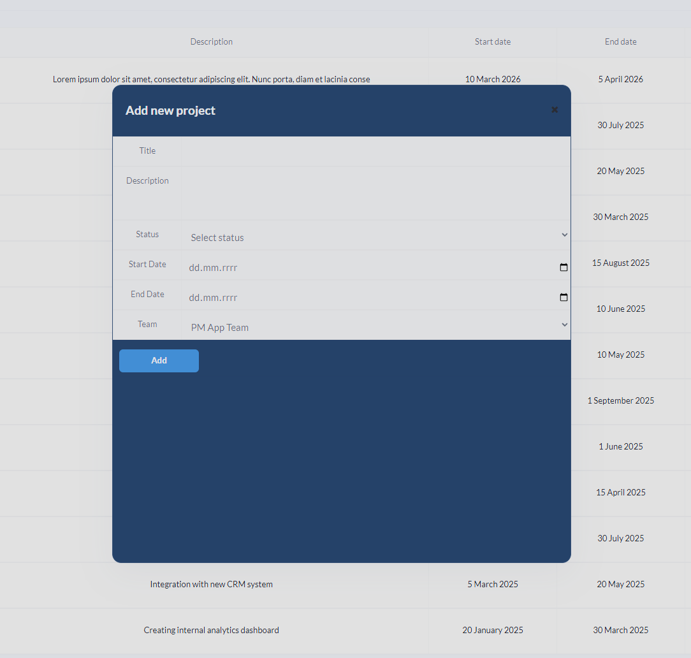

  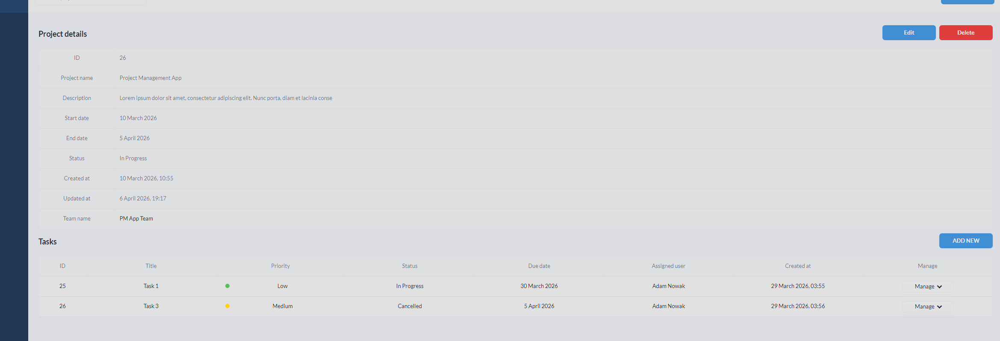

  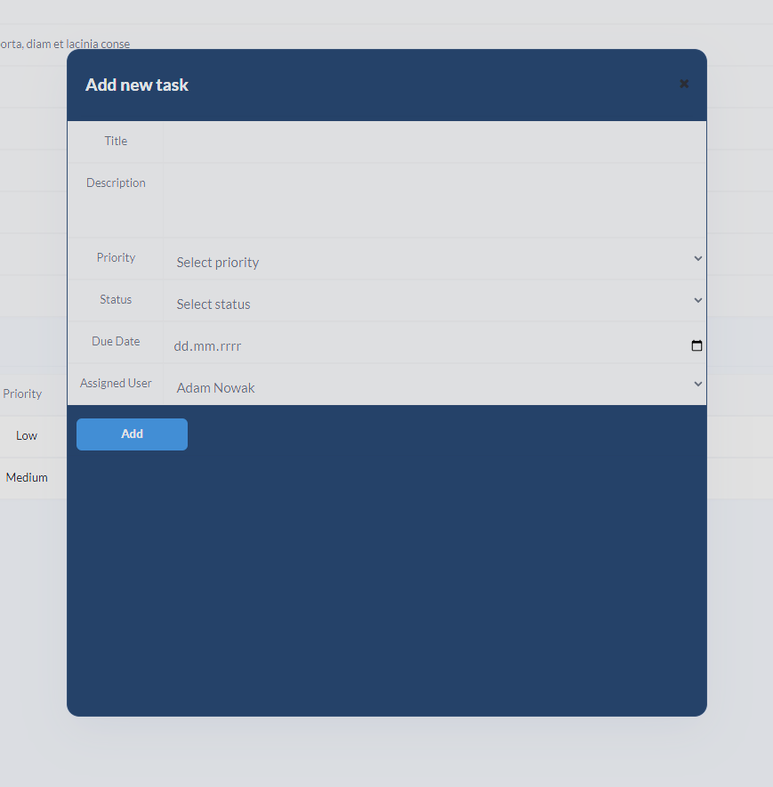

  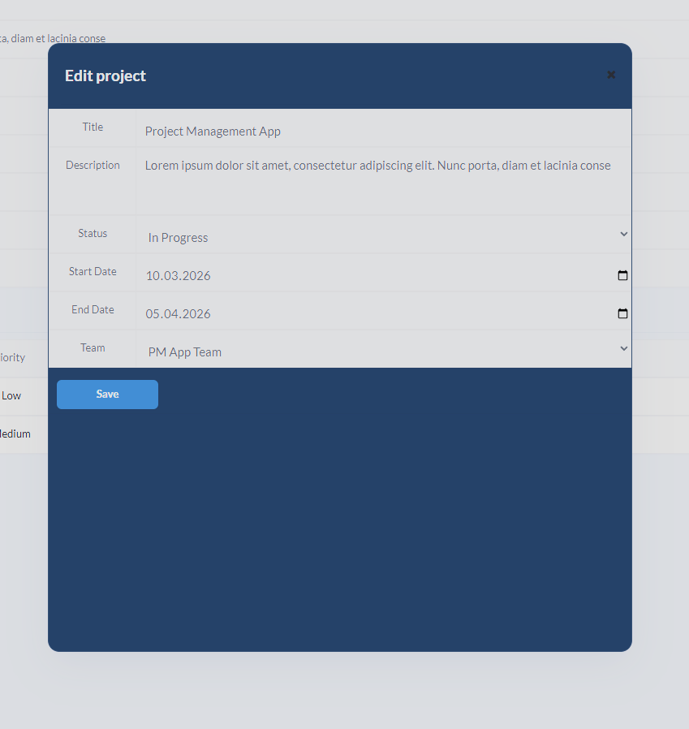

### Zadania i zespoły

  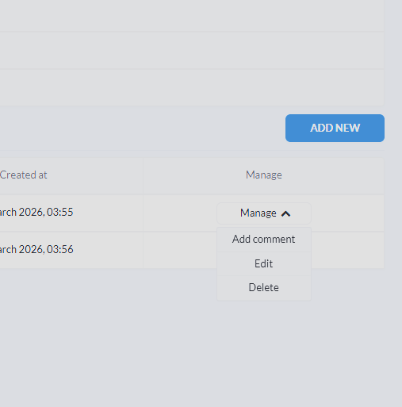

  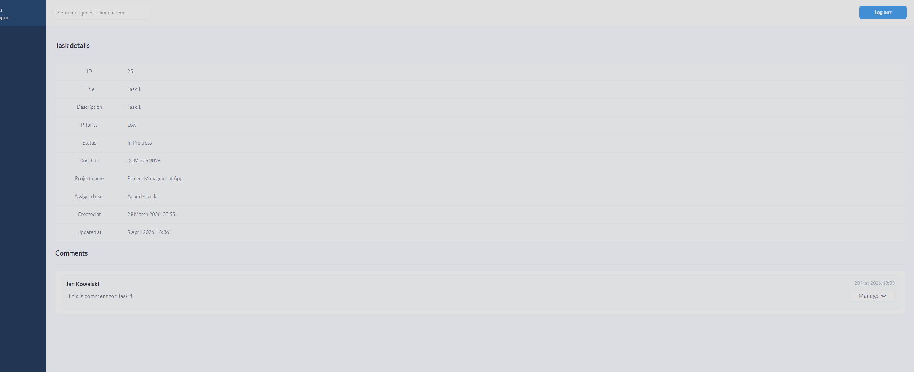

  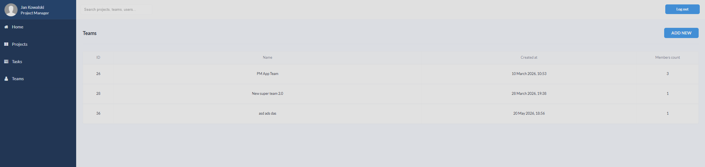

  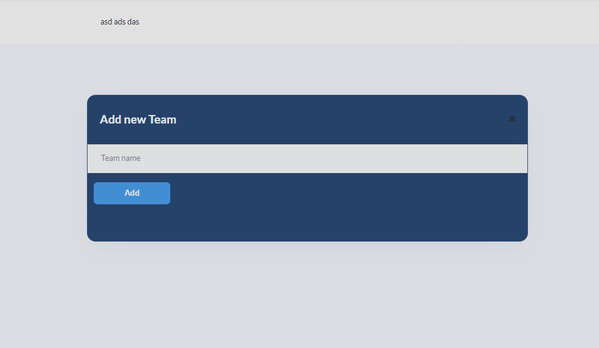

  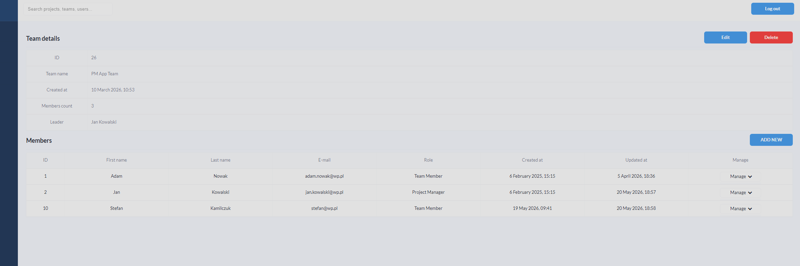

  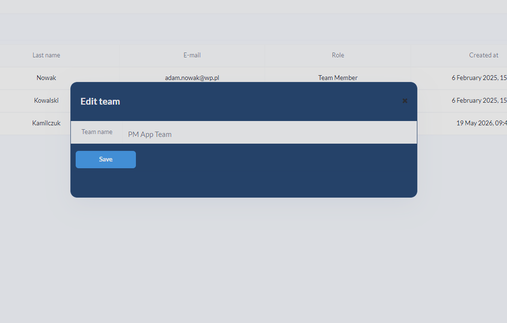

  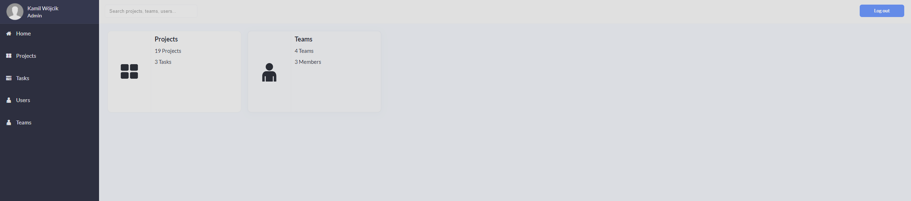

  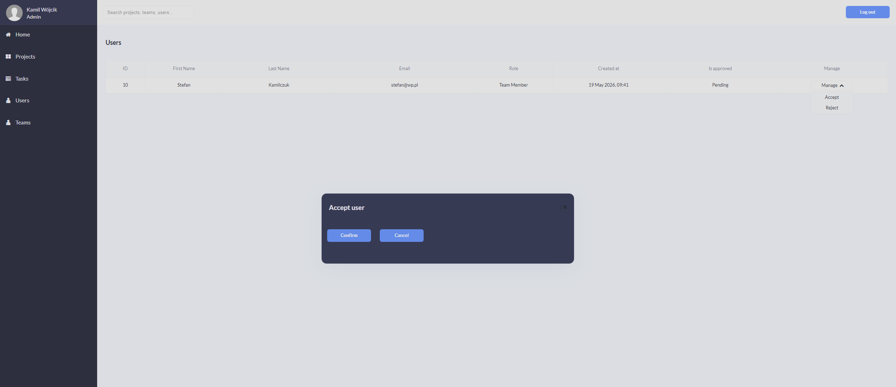

  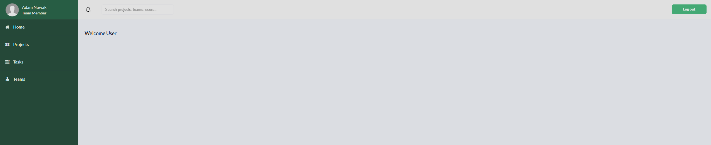

  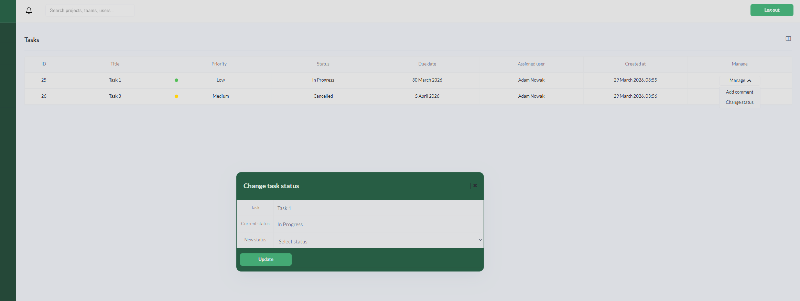

  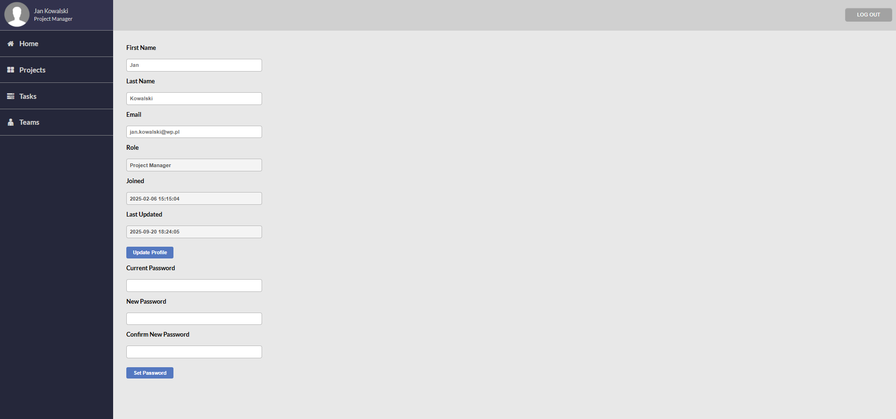

